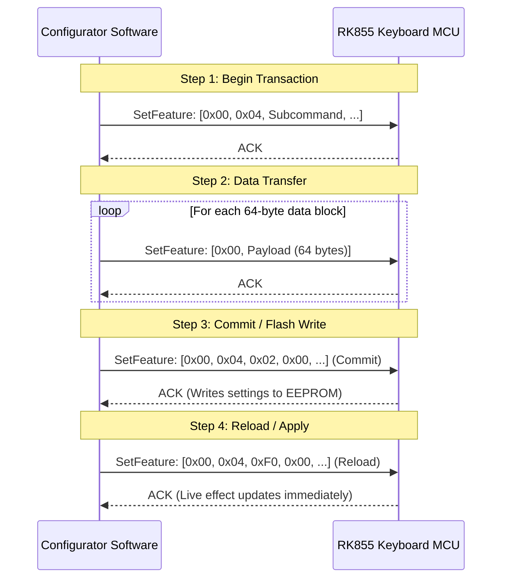

# Reverse Engineering Analysis: Royal Kludge RK855 Keyboard Configurator

## 1. Executive Summary

This document presents the reverse engineering analysis of `RK855 configurator.exe` (SHA-256: `d31b8e8cda53c595809be2ea7f9c86b2bdb945e277a4e0f9f2504c53e2fbe7f0`), the official Windows configuration software for the Royal Kludge RK855 (RK68) mechanical keyboard.

The analysis reveals the internal packaging structure, the complete USB HID configuration protocol, the 20 built-in RGB lighting modes, the per-key RGB matrix format, the key remapping mechanism, the macro transmission format, and the physical 68-key scan code matrix. This specification provides everything needed to implement an alternative, cross-platform keyboard configurator (e.g. for Linux, macOS, or OpenRGB).

---

## 2. Packaging Breakdown & Extraction

### 2.1 Outer Installer Container
- **Filename**: `RK855 configurator.exe`
- **File Size**: 9,116,150 bytes (~8.69 MB)
- **Container Type**: InstallShield 32-bit bootstrap wrapper.
- **PE Header Size**: 1,257,472 bytes (Setup loader executable).
- **Overlay Size**: 7,858,678 bytes starting at file offset `0x00133000`.

### 2.2 Unpacking Procedure
The overlay stores an uncompressed archive table of InstallShield files with UTF-16LE file metadata and byte lengths:
1. `0x0409.ini`, `0x0804.ini`, `0x0404.ini` (Localization strings).
2. `setup.ini` (Product definition: `Product=RK 68`, `ProductGUID=4A067FBD-C346-4B00-9080-7351B15BA2B2`).
3. `data1.cab`, `data2.cab`, `data1.hdr` (InstallShield Cabinet archives).

Extracting `data1.cab` using `unshield` yields the core payload files:
- **`DefaultComponent/DeviceDriver.exe`** (1,620,992 bytes): The actual application executable.
- **`DefaultComponent/mui.dll`** (1,059,840 bytes): Custom Modern UI control framework.
- **`DefaultComponent/device.xml`**: Hardware configuration and USB device filters.
- **`DefaultComponent/KeyboardLayout.xml`**: Physical key coordinates and default scan codes.
- **`Files1/1033.lan`**: English UI definitions, lighting effect names, and key function mappings.

---

## 3. USB Device Interface

### 3.1 Device Identification
From `device.xml`:
- **Single Device Identifier**: `RK KeyBoard 68K`
- **Vendor ID (VID)**: `0x0C45` (Sonix Technology Co., Ltd.)
- **Product ID (PID)**: `0x8018`
- **Alternative Profile**: `VID: 0x05AC`, `PID: 0x024F` (Mac layout mode)

### 3.2 USB Transport
- **Class**: USB HID (Human Interface Device)
- **Communication Channel**: Vendor-defined HID Feature Reports
- **Report ID**: `0x00`
- **Buffer Length**: 65 bytes:
  - Byte 0: Report ID (`0x00`)
  - Bytes 1..64: 64-byte payload

---

## 4. USB HID Protocol & Transaction Architecture

All communication with the keyboard follows a strict **Begin → Data Transfer → Commit → Sync** transaction lifecycle.



### 4.1 Transaction Header Codes (Byte 0 = `0x04`)

| Subcommand Byte 1 | Purpose | Payload Size | Description |
| :---: | :--- | :---: | :--- |
| `0x18` | **Begin Light Mode** | 64 B | Prepares MCU for lighting profile transfer |
| `0x11` | **Set Standard Light** | 64 B | Sends lighting mode ID, brightness, speed, direction, color |
| `0x13` | **Custom Light Header**| 64 B | Signals transfer of per-key RGB matrix (Byte 8 = `0x12`) |
| `0x20` | **Begin Key Remap** | 64 B | Prepares key remapping table transfer |
| `0x19` | **Begin Macro** | 64 B | Prepares keystroke macro sequence transfer |
| `0x15` | **Macro Data** | 64 B | Macro stream (prefixed with `0xAA, 0x55`) |
| `0x02` | **Commit Changes** | 64 B | Commits staged data to non-volatile memory |
| `0xF0` | **Reload / Apply** | 64 B | Tells MCU to reload and immediately apply active state |

---

## 5. RGB Lighting Subsystem

### 5.1 Built-in Lighting Modes (from `1033.lan`)

The keyboard MCU has 20 hardcoded lighting effect algorithms:

| Mode ID (Hex) | Mode ID (Dec) | Display Name | Supported Parameters |
| :---: | :---: | :--- | :--- |
| `0x00` | 200 | **Static** | Brightness, Color |
| `0x01` | 201 | **SingleOn** | Brightness, Speed, Color |
| `0x02` | 202 | **SingleOff** | Brightness, Speed, Color |
| `0x03` | 203 | **Glittering** | Brightness, Speed, Color |
| `0x04` | 204 | **Falling** | Brightness, Speed, Color |
| `0x05` | 205 | **Colourful** | Brightness, Speed |
| `0x06` | 206 | **Breath** | Brightness, Speed, Color |
| `0x07` | 207 | **Spectrum** | Brightness, Speed |
| `0x08` | 208 | **Outward** | Brightness, Speed, Color |
| `0x09` | 209 | **Scrolling** | Brightness, Speed, Direction |
| `0x0A` | 210 | **Rolling** | Brightness, Speed, Direction |
| `0x0B` | 211 | **Rotating** | Brightness, Speed, Direction |
| `0x0C` | 212 | **Explode** | Brightness, Speed, Color |
| `0x0D` | 213 | **Launch** | Brightness, Speed, Color |
| `0x0E` | 214 | **Ripples** | Brightness, Speed, Color |
| `0x0F` | 215 | **Flowing** | Brightness, Speed, Direction |
| `0x10` | 216 | **Pulsating** | Brightness, Speed |
| `0x11` | 217 | **Tilt** | Brightness, Speed, Direction |
| `0x12` | 218 | **Shuttle** | Brightness, Speed, Direction |
| `0x13` | 219 | **Off (Close Backlight)** | None |

### 5.2 Lighting Parameters Structure
When sending command `0x04 0x11`:
- **Byte 0**: `0x04`
- **Byte 1**: `0x11`
- **Byte 2**: Mode ID (`0x00` – `0x13`)
- **Byte 3**: Color Type (`0x00` = Random/RGB Rainbow, `0x01` = Preset Solid Color, `0x02` = Custom Color)
- **Byte 4**: Red component (`0x00` – `0xFF`)
- **Byte 5**: Green component (`0x00` – `0xFF`)
- **Byte 6**: Blue component (`0x00` – `0xFF`)
- **Byte 7**: Brightness Level (`0` – `4`)
- **Byte 8**: Speed Level (`0` – `4`, `0x0A` default)
- **Byte 9**: Direction (`0x00` = Left-to-Right / Clockwise, `0x01` = Right-to-Left / Counter-clockwise)

### 5.3 Per-Key Custom RGB Lighting Protocol
To set custom static RGB illumination per individual key:
1. Send Init: `[0x00, 0x04, 0x18, ...0x00]`
2. Send Header: `[0x00, 0x04, 0x13, 0x00, 0x00, 0x00, 0x00, 0x00, 0x12, ...0x00]`
3. Send RGB Matrix:
   - Total Data Size: **1,216 bytes** (`0x4C0`)
   - Transmitted as **19 consecutive 64-byte HID reports**.
   - Each key is assigned 3 bytes: `[R, G, B]`, indexed by its matrix position.
4. Send Commit: `[0x00, 0x04, 0x02, ...0x00]`
5. Send Reload: `[0x00, 0x04, 0xF0, ...0x00]`

---

## 6. Key Remapping Subsystem

### 6.1 Transaction Format
To remap keyboard keys:
1. Send Init: `[0x00, 0x04, 0x20, 0x00, 0x00, 0x00, 0x00, 0x00, 0x04, ...0x00]`
2. Send Mapping Table:
   - Size: **256 bytes** (`0x100`), sent in **4 consecutive 64-byte reports**.
   - Each key entry is a 2-byte tuple: `[PhysicalKeyCode, TargetFunctionCode]`
3. Send Commit: `[0x00, 0x04, 0x02, ...0x00]`

### 6.2 Supported Remap Action Types

| Category ID | Name | Sub-functions |
| :---: | :--- | :--- |
| `120` | **Disabled** | Key produces no output |
| `121` | **Standard Key** | Any standard USB HID keycode (A-Z, 0-9, F1-F12, modifiers) |
| `122` | **Macro Trigger**| Executes recorded macro ID (1..N) |
| `124` | **Mouse Button** | Left, Right, Middle, Double-Click, Scroll Up/Down, Button 4, Button 5 |
| `125` | **Multimedia** | Play/Pause, Stop, Prev, Next, Volume+, Volume-, Mute |
| `126` | **Windows Shortcut**| Desktop, Explorer, Lock PC, Close, Task Switch, Sleep, Power |
| `127` | **Launch App** | Executes target program path (handled by desktop software) |
| `128` | **Open URL** | Launches browser URL (handled by desktop software) |
| `129` | **Text String** | Injects saved keystroke string |
| `130` | **Switch Profile** | Toggles keyboard onboard profile (1, 2, or 3) |

---

## 7. Complete Physical 68-Key Scan Code Matrix

Extracted directly from `KeyboardLayout.xml` for `Layout855` / `LayoutW855`:

| Key Name | Scan Code (Hex) | Key Name | Scan Code (Hex) | Key Name | Scan Code (Hex) |
| :--- | :---: | :--- | :---: | :--- | :---: |
| **ESC** | `0x29` | **Q** | `0x14` | **A** | `0x04` |
| **1** | `0x1E` | **W** | `0x1A` | **S** | `0x16` |
| **2** | `0x1F` | **E** | `0x08` | **D** | `0x07` |
| **3** | `0x20` | **R** | `0x15` | **F** | `0x09` |
| **4** | `0x21` | **T** | `0x17` | **G** | `0x0A` |
| **5** | `0x22` | **Y** | `0x1C` | **H** | `0x0B` |
| **6** | `0x23` | **U** | `0x18` | **J** | `0x0D` |
| **7** | `0x24` | **I** | `0x0C` | **K** | `0x0E` |
| **8** | `0x25` | **O** | `0x12` | **L** | `0x0F` |
| **9** | `0x26` | **P** | `0x13` | **; :** | `0x33` |
| **0** | `0x27` | **[ {** | `0x2F` | **' "** | `0x34` |
| **- _** | `0x2D` | **] }** | `0x30` | **ENTER** | `0x28` |
| **= +** | `0x2E` | **\\ \|** | `0x31` | **PAGE UP**| `0x4B` |
| **BACKSPACE**| `0x2A` | **DELETE** | `0x4C` | **PAGE DOWN**| `0x4E` |
| **` ~** | `0x35` | **CAPS LOCK**| `0x39` | **ARROW UP** | `0x52` |
| **TAB** | `0x2B` | **LSHIFT** | `0xE1` | **ARROW LEFT**| `0x50` |
| **Z** | `0x1D` | **RSHIFT** | `0xE5` | **ARROW DOWN**| `0x51` |
| **X** | `0x1B` | **LCTRL** | `0xE0` | **ARROW RIGHT**| `0x4F` |
| **C** | `0x06` | **LWIN** | `0xE3` | **RCTRL** | `0xE4` |
| **V** | `0x19` | **LALT** | `0xE2` | **FN** | `0xAF` |
| **B** | `0x05` | **SPACE** | `0x2C` | **RALT** | `0xE6` |
| **N** | `0x11` | **, <** | `0x36` | **. >** | `0x37` |
| **M** | `0x10` | **/ ?** | `0x38` | | |

---

## 8. Embedded Database Schema

`DeviceDriver.exe` embeds an internal SQLite storage engine to persist user profiles, custom lights, and macros:

```sql
CREATE TABLE t_light_data (
    light_id INTEGER PRIMARY KEY AUTOINCREMENT,
    profile INTEGER,
    name TEXT,
    mode INTEGER,          -- Lighting Mode 0..19
    colortype INTEGER,     -- 0: Rainbow, 1: Preset, 2: Custom
    byte2 INTEGER,         -- Red component
    byte3 INTEGER,         -- Green component
    byte4 INTEGER,         -- Blue component
    byte5 INTEGER,         -- Brightness (0..4)
    byte6 INTEGER,         -- Speed (0..4)
    byte7 INTEGER,         -- Direction (0: L->R, 1: R->L)
    sel INTEGER
);

CREATE TABLE t_customlight_data (
    customlight_id INTEGER PRIMARY KEY AUTOINCREMENT,
    profile INTEGER,
    name TEXT,
    speed INTEGER,
    brightness INTEGER
);

CREATE TABLE t_customrgb_data (
    customrgb_id INTEGER PRIMARY KEY AUTOINCREMENT,
    customlight_id INTEGER,
    keycode INTEGER,       -- Physical Key Scan Code (e.g., 0x29 for ESC)
    rgbvalue INTEGER,      -- Packed 0x00RRGGBB
    light_mode INTEGER,
    colortype INTEGER,
    light_type INTEGER
);

CREATE TABLE t_key_data (
    key_id INTEGER PRIMARY KEY AUTOINCREMENT,
    profile INTEGER,
    keyvalue INTEGER,      -- Original Scan Code
    macrotype INTEGER,     -- Remap Action Type (120..130)
    macrovalue INTEGER,    -- Remapped Keycode or Action ID
    macro2value INTEGER,
    macro3value INTEGER,
    macrodesc TEXT
);
```

---

## 9. Implementation Blueprint: Python Configurator

The following Python script demonstrates setting lighting modes, brightness, speed, and custom colors on the RK855 using `hidapi`:

```python
import hid
import time

VID = 0x0C45
PID = 0x8018

def send_packet(dev, payload):
    """Sends a 65-byte Feature Report: [ReportID(0x00), Payload(64 bytes)]"""
    buf = bytes([0x00]) + bytes(payload).ljust(64, b"\x00")
    dev.send_feature_report(buf)
    time.sleep(0.005) # 5ms delay between commands

def set_light_mode(mode_id, brightness=3, speed=2, r=255, g=0, b=128):
    """
    Sets the keyboard lighting mode.
    Modes: 0 (Static), 6 (Breath), 14 (Ripples), 15 (Flowing), 19 (Off), etc.
    """
    dev = hid.device()
    dev.open(VID, PID)
    print(f"[+] Connected to RK855 (VID:0x{VID:04X}, PID:0x{PID:04X})")

    try:
        # Step 1: Begin Light Configuration
        send_packet(dev, [0x04, 0x18])

        # Step 2: Set Mode Parameters
        # [0x04, 0x11, mode, color_type, R, G, B, brightness, speed, direction]
        color_type = 0x01 # Preset solid color
        direction = 0x00  # Left to right
        send_packet(dev, [0x04, 0x11, mode_id, color_type, r, g, b, brightness, speed, direction])

        # Step 3: Commit Changes to Onboard Flash
        send_packet(dev, [0x04, 0x02])

        # Step 4: Apply & Sync Live Effects
        send_packet(dev, [0x04, 0xF0])
        print(f"[+] Light mode {mode_id} applied successfully.")
    finally:
        dev.close()

if __name__ == "__main__":
    # Example: Set Static Magenta backlight with maximum brightness
    set_light_mode(mode_id=0, brightness=4, speed=2, r=255, g=0, b=255)
```
