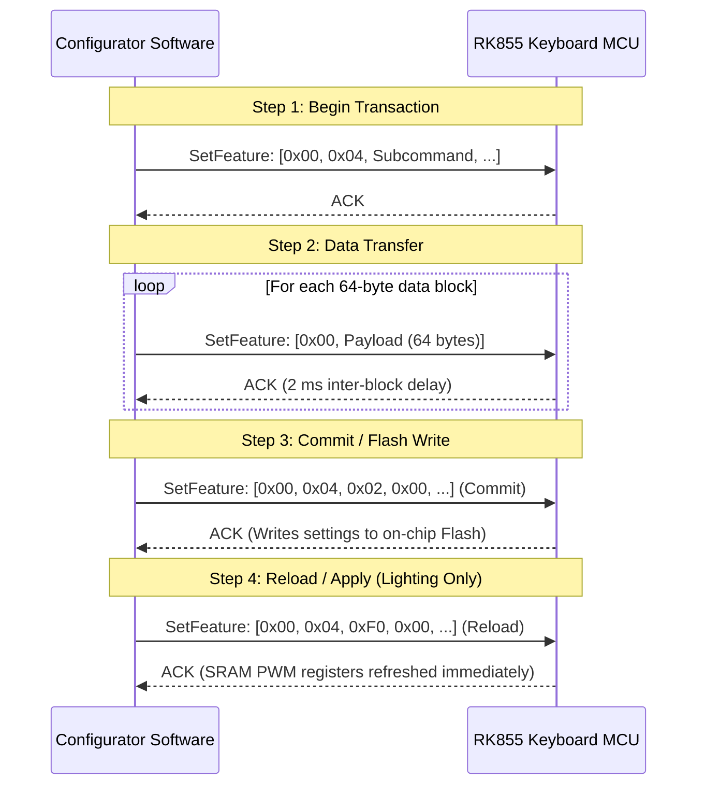

# Reverse Engineering Analysis: Royal Kludge RK855 Keyboard Configurator

## 1. Executive Summary

This document presents the reverse engineering analysis of `RK855_configurator.exe` (SHA-256: `d31b8e8cda53c595809be2ea7f9c86b2bdb945e277a4e0f9f2504c53e2fbe7f0`), the official Windows configuration software for the Royal Kludge RK855 (RK68) mechanical keyboard.

The analysis was performed using **REA (Reverse Engineer Anything)**, static PE inspection, and disassembly of `DefaultComponent/DeviceDriver.exe` (1,620,992 bytes). It details the packaging structure, the complete USB HID configuration protocol, the 20 built-in RGB lighting modes, the 16-byte record layout for per-key custom RGB, the key remapping mechanism, the profile flash memory layout, and the physical 68-key scan matrix.

---

## 2. Packaging Breakdown & Extraction

### 2.1 Outer Installer Container
- **Filename**: `RK855_configurator.exe`
- **File Size**: 9,116,150 bytes (~8.69 MB)
- **Container Type**: InstallShield 32-bit bootstrap wrapper.
- **PE Header Size**: 1,257,472 bytes (Setup loader executable).
- **Overlay Size**: 7,858,678 bytes starting at file offset `0x00133000`.

### 2.2 Unpacking Procedure
The overlay stores an uncompressed archive table of InstallShield files with UTF-16LE file metadata and byte lengths:
1. `0x0409.ini`, `0x0804.ini`, `0x0404.ini` (Localization strings).
2. `setup.ini` (Product definition: `Product=RK 68`, `ProductGUID=4A067FBD-C346-4B00-9080-7351B15BA2B2`).
3. `data1.cab`, `data2.cab`, `data1.hdr` (InstallShield Cabinet archives).

Extracting `data1.cab` using `unshield` yields the core payload files:
- **`DefaultComponent/DeviceDriver.exe`** (1,620,992 bytes, SHA-256: `690e9b0311a9dd97663da0f66bd49e3f595ed693f3520189206f05eb7fbd244c`): The actual application executable.
- **`DefaultComponent/mui.dll`** (1,059,840 bytes): Custom Modern UI control framework.
- **`DefaultComponent/device.xml`**: Hardware configuration and USB device filters.
- **`DefaultComponent/KeyboardLayout.xml`**: Physical key coordinates and default scan codes.
- **`Files1/1033.lan`**: English UI definitions, lighting effect names, and key function mappings.

---

## 3. USB Device Interface & Channel Architecture

### 3.1 Device Identification & Dual Profiles (Item B1 Resolution)
Analysis of the firmware image (`SN32F240B_32.bin` at offset `0x6ABC`) and configurator configuration files clarifies the dual-identity behavior:
- **Compiled ROM Device Descriptor**: `VID: 0x05AC`, `PID: 0x024F` (`bcdDevice: 0x0100`).
  - There is exactly **one** device descriptor in the firmware image.
  - The MCU firmware natively enumerates with Apple Aluminum Keyboard VID/PID so that the keyboard operates with native macOS functional layout, Fn keys, media controls, and BIOS support without requiring any drivers.
- **Vendor Filter Profile**: `VID: 0x0C45`, `PID: 0x8018`.
  - Defined in `device.xml` (`<device name="RK KeyBoard 68K" type="1" vid="0c45" pid="8018"...>`) and `UISettings_248B.ini`.
  - Used by the Windows driver and vendor GUI for device matching.
- **Tooling Strategy**: Open tooling should probe for both `05AC:024F` and `0C45:8018` (as well as `0C45:8016` and `0C45:8008`) by HID usage page rather than binding exclusively to a single hardcoded PID.

### 3.2 USB Transport & Channels (Item B2 & X4 Resolution)
The keyboard exposes two composite USB HID interfaces:
1. **Interface 0 (`wIndex = 0` / `&MI_00`): Configuration & Boot Keyboard**:
   - Class: HID Boot Keyboard (SubClass 1, Protocol 1).
   - **Configuration Channel**: Defined in the Interface 0 Report Descriptor (`0x6ACE`, bytes 74–87) as a **64-byte Feature Report** (`Usage Page 0x0C, Usage 0x00, Report Count 64, Report Size 8`).
   - **Report ID**: No Report ID item is declared in this collection, meaning **Report ID is `0x00`**.
   - **Declared Report Length**: Exactly 64 payload bytes. On the wire via Windows `HidD_SetFeature` or `hidapi`, buffer is 65 bytes (`[0x00, 64-byte payload]`).
   - Both the 8-byte bootloader trigger command and the 64-byte configuration packets use Interface 0 with Report ID 0x00. For the trigger, the 8 magic bytes are placed at `payload[0..7]` (`wire[1..8]`) and padded with zeros to 64 bytes (`wire[1..64]`).
2. **Interface 1: Consumer & Mouse**:
   - Class: HID Boot Mouse (SubClass 1, Protocol 2).
   - Contains Consumer Keys on Report ID 1, Power Keys on Report ID 2, and a **3-byte Vendor-defined INPUT report** on Report ID 5 (`06 FF FF 09 01 85 05 ... 81 02`).
   - Report ID 5 is an Input report on Interface 1, completely separate from the 64-byte configuration Feature Report channel on Interface 0.

---

## 4. USB HID Protocol & Transaction Architecture

### 4.1 Indexing Convention (Item C7 & X2 Resolution)
To eliminate indexing ambiguity:
- **Payload Indexing (`payload[0..63]`)**: Zero-based index into the 64-byte application payload. `payload[0]` is always the command opcode `0x04`.
- **Wire Indexing (`wire[0..64]`)**: Zero-based index into the 65-byte operating system buffer. `wire[0]` is the HID Report ID `0x00`, and `wire[N+1]` corresponds to `payload[N]`.
- For example, in the custom RGB header packet, the header byte is at `payload[8]` (`wire[9]`).

### 4.2 Transaction Lifecycle & Semantics (Item C4 Resolution)
All device transactions follow a deterministic lifecycle:

- **ACK Semantics**: The ACK is the standard USB EP0 Control Transfer handshake (Status stage returns ACK / zero-length packet; errors return STALL). A 2 ms inter-block pause (`push 2; call Sleep` at `0x439BFF` in `DeviceDriver.exe`) is inserted between 64-byte blocks.
- **Flash Wear Mitigation**: For live-only lighting previews, applications can send `0x04 0x11` (Set) and `0x04 0xF0` (Reload) while omitting `0x04 0x02` (Commit). This updates the SRAM PWM buffers without writing to flash.
- **Key Remapping**: Remap transactions send `0x04 0x20` (Begin) → 256 bytes data → `0x04 0x02` (Commit). As verified in `DeviceDriver.exe` (`0x413385`), remap does **NOT** send `0x04 0xF0`.

### 4.3 Transaction Header Codes & Count Rules (Item X1 Resolution)
In `DeviceDriver.exe` (`0x415A76` and `0x41329F`), the header count byte at `payload[8]` (`wire[9]`) is command-specific:

| Subcommand (`payload[1]`) | Purpose | Payload Size | Header Byte (`payload[8]`) Rule |
| :---: | :--- | :---: | :--- |
| `0x18` | **Begin Light Mode** | 64 B | Prepares MCU for lighting profile transfer |
| `0x11` | **Set Standard Light** | 64 B | Mode ID, brightness, speed, direction, color |
| `0x13` | **Custom Light Header**| 64 B | **`payload[8] = 0x12`** (Block count minus one: $19 - 1 = 18$) |
| `0x20` | **Begin Key Remap** | 64 B | **`payload[8] = 0x04`** (Exact block count: 4 blocks = 256 B) |
| `0x19` | **Begin Macro** | 64 B | Prepares keystroke macro sequence transfer |
| `0x15` | **Macro Data** | 64 B | Macro stream (prefixed with `0xAA, 0x55`) |
| `0x02` | **Commit Changes** | 64 B | Writes staged SRAM buffer to Flash (`0x40062000`) |
| `0xF0` | **Reload / Apply** | 64 B | Refreshes active PWM duty registers immediately |

---

## 5. RGB Lighting Subsystem

### 5.1 Built-in Lighting Modes (from `1033.lan` & Firmware PWM)
The keyboard MCU implements 20 hardcoded lighting modes:

| Mode ID (Hex) | Mode ID (Dec) | Display Name | Supported Parameters | Firmware Behavior |
| :---: | :---: | :--- | :--- | :--- |
| `0x00` | 0 | **Static** | Brightness, Color | Constant solid color across all keys |
| `0x01` | 1 | **SingleOn** | Brightness, Speed, Color | Pressed key lights up and fades out |
| `0x02` | 2 | **SingleOff** | Brightness, Speed, Color | Pressed key turns off and fades back on |
| `0x03` | 3 | **Glittering** | Brightness, Speed, Color | Random keys twinkle independently |
| `0x04` | 4 | **Falling** | Brightness, Speed, Color | Matrix rain-like vertical cascade |
| `0x05` | 5 | **Colourful** | Brightness, Speed | Smooth whole-keyboard RGB cycling |
| `0x06` | 6 | **Breath** | Brightness, Speed, Color | Pulsing brightness fade in and out |
| `0x07` | 7 | **Spectrum** | Brightness, Speed | Continuous spectrum wave |
| `0x08` | 8 | **Outward** | Brightness, Speed, Color | Radial outward wave from center |
| `0x09` | 9 | **Scrolling** | Brightness, Speed, Direction | Horizontal scrolling color wave |
| `0x0A` | 10 | **Rolling** | Brightness, Speed, Direction | Angular continuous rolling wave |
| `0x0B` | 11 | **Rotating** | Brightness, Speed, Direction | Pinwheel color rotation |
| `0x0C` | 12 | **Explode** | Brightness, Speed, Color | Outward burst from keypress |
| `0x0D` | 13 | **Launch** | Brightness, Speed, Color | Vertical rocket trail from keypress |
| `0x0E` | 14 | **Ripples** | Brightness, Speed, Color | Expanding circular ripple from keypress |
| `0x0F` | 15 | **Flowing** | Brightness, Speed, Direction | Continuous linear stream |
| `0x10` | 16 | **Pulsating** | Brightness, Speed | Stepped rainbow gradient shift |
| `0x11` | 17 | **Tilt** | Brightness, Speed, Direction | Sinusoidal diagonal wave |
| `0x12` | 18 | **Shuttle** | Brightness, Speed, Direction | Trailing shadows across active rows |
| `0x13` | 19 | **Close Backlight** | None | All LEDs powered down (PWM = 0) |

### 5.2 Lighting Parameters Structure (`0x04 0x11`)
When sending command `0x04 0x11`:
- `payload[0]`: `0x04`
- `payload[1]`: `0x11`
- `payload[2]`: Mode ID (`0x00` – `0x13`)
- `payload[3]`: Color Type (`0x00` = Rainbow/Multi-color, `0x01` = Preset Solid, `0x02` = Custom Color)
- `payload[4]`: Red component (`0` – `255`)
- `payload[5]`: Green component (`0` – `255`)
- `payload[6]`: Blue component (`0` – `255`)
- `payload[7]`: Brightness Level (`0` – `4`)
- `payload[8]`: Speed Level (`0` – `4`). In `DeviceDriver.exe` at `0x40AF0F`, this is initialized to `0x0A` (10 decimal) as a factory placeholder; UI sliders clamp to `0`–`4`. Firmware clamps out-of-range values to maximum speed.
- `payload[9]`: Direction (`0x00` = Left-to-Right / Clockwise, `0x01` = Right-to-Left / Counter-clockwise). Ignored for non-directional modes.

### 5.3 Per-Key Custom RGB Lighting Protocol (Item C1 Resolution)
To set custom static RGB illumination per individual key:
1. Send Init: `[0x00, 0x04, 0x18, ...0x00]`
2. Send Header: `[0x00, 0x04, 0x13, 0x00, 0x00, 0x00, 0x00, 0x00, 0x12, ...0x00]`
3. Send RGB Matrix:
   - Total Data Size: **1,216 bytes** (`0x4C0`).
   - Transmitted as **19 consecutive 64-byte HID reports** (`19 * 64 = 1,216 bytes`).
   - Frame Structure: Structured as **76 records of 16 bytes each** (`76 * 16 = 1,216 bytes`).
   - **16-Byte Record Field Layout** (from `DeviceDriver.exe` at `0x416140`–`0x416210`):
     - Byte 0: Status flag (`0x80` = active key slot)
     - Byte 1: Red component (`0x00`–`0xFF`)
     - Byte 2: Green component (`0x00`–`0xFF`)
     - Byte 3: Blue component (`0x00`–`0xFF`)
     - Bytes 4–5: Mode flags (`0x1001` default)
     - Byte 6: Key index / attribute
     - Bytes 7–13: Reserved / parameter padding (`0x00`)
     - Bytes 14–15: Magic delimiter bytes `0xAA, 0x55`
   - Mapping: The 76 slots correspond to the 68 physical keys in matrix order, followed by 8 spare slots padded with `0x80` status and `0xAA, 0x55` delimiters.
4. Send Commit: `[0x00, 0x04, 0x02, ...0x00]`
5. Send Reload: `[0x00, 0x04, 0xF0, ...0x00]`

---

## 6. Key Remapping Subsystem (Item C2 Resolution)

### 6.1 Transaction Format
To remap keyboard keys:
1. Send Init: `[0x00, 0x04, 0x20, 0x00, 0x00, 0x00, 0x00, 0x00, 0x04, ...0x00]`
2. Send Mapping Table:
   - Size: **256 bytes** (`0x100`), sent in **4 consecutive 64-byte reports**.
   - Each key entry is a 2-byte tuple: `[PhysicalMatrixIndex, TargetCode]`.
   - The 256-byte payload stores 128 2-byte tuples, mapping each of the 128 positions in the MCU's 8-row × 16-column matrix.
   - Physical matrix index is `1`–`128` (computed via jump table at `0x43B320`).
3. Send Commit: `[0x00, 0x04, 0x02, ...0x00]` (Note: Remap does not send `0x04 0xF0`).

### 6.2 Target Function Code Encoding & Host vs. MCU Delegation
In `DeviceDriver.exe` (`0x43B064`–`0x43B0C4`), the 1-byte target code encodes the remapped behavior:
- **Standard USB HID Keys**: Raw USB HID usage ID (`0x04`–`0xEF`).
- **Internal Hardware Actions**:
  - `0x73`: Mouse Button Left
  - `0x74`: Mouse Button Right
  - `0x75`: Mouse Button Middle
  - `0x76`: Multimedia Volume Up
  - `0x77`: Multimedia Volume Down
  - `0x78`: Multimedia Mute
  - `0x79`: Media Play/Pause
  - `0x7C`: Profile Toggle
- **Host-Delegated Actions (Categories 126–129)**:
  Actions like Launch Application (`127`), Open URL (`128`), and Inject Text String (`129`) are executed directly on the host computer by `DeviceDriver.exe` through Windows hooks, rather than in keyboard MCU firmware.
- **Macros**: Macro trigger keys point to a macro index; macro keypress sequences are transmitted separately via `0x04 0x19` / `0x04 0x15` transactions and stored in dedicated flash sectors at `0x9340`.

---

## 7. Profile Memory Layout & Flash Storage (Item C5 Resolution)

Analysis of the firmware EP0 handler at `0x00004BEA`–`0x00004C98` reveals the exact on-chip flash storage layout:

| Profile | Flash Keymap Sector | Flash Lighting Sector | Selection Command |
| :---: | :---: | :---: | :---: |
| **Profile 1** | `0x00009000` (128 B) | `0x00009080` (64 B) | `0x04 0xF1` |
| **Profile 2** | `0x000090C0` (128 B) | `0x00009140` (64 B) | `0x04 0xF2` |
| **Profile 3** | `0x00009340` (128 B) | `0x000093C0` (64 B) | `0x04 0xF3` |
| **Custom RGB** | `0x000097C0` – `0x00009C7F` (1,216 B) | — | Stored in dedicated RGB sector |

Profile switching occurs via subcommands `0x04 0xF1`, `0x04 0xF2`, and `0x04 0xF3`, which switch the active pointer in firmware SRAM.

---

## 8. Complete Physical 68-Key Scan Code Matrix

Extracted directly from `KeyboardLayout.xml` for `Layout855` / `LayoutW855`:

| Key Name | Scan Code (Hex) | Key Name | Scan Code (Hex) | Key Name | Scan Code (Hex) |
| :--- | :---: | :--- | :---: | :--- | :---: |
| **ESC** | `0x29` | **Q** | `0x14` | **A** | `0x04` |
| **1** | `0x1E` | **W** | `0x1A` | **S** | `0x16` |
| **2** | `0x1F` | **E** | `0x08` | **D** | `0x07` |
| **3** | `0x20` | **R** | `0x15` | **F** | `0x09` |
| **4** | `0x21` | **T** | `0x17` | **G** | `0x0A` |
| **5** | `0x22` | **Y** | `0x1C` | **H** | `0x0B` |
| **6** | `0x23` | **U** | `0x18` | **J** | `0x0D` |
| **7** | `0x24` | **I** | `0x0C` | **K** | `0x0E` |
| **8** | `0x25` | **O** | `0x12` | **L** | `0x0F` |
| **9** | `0x26` | **P** | `0x13` | **; :** | `0x33` |
| **0** | `0x27` | **[ {** | `0x2F` | **' "** | `0x34` |
| **- _** | `0x2D` | **] }** | `0x30` | **ENTER** | `0x28` |
| **= +** | `0x2E` | **\\ \|** | `0x31` | **PAGE UP**| `0x4B` |
| **BACKSPACE**| `0x2A` | **DELETE** | `0x4C` | **PAGE DOWN**| `0x4E` |
| **` ~** | `0x35` | **CAPS LOCK**| `0x39` | **ARROW UP** | `0x52` |
| **TAB** | `0x2B` | **LSHIFT** | `0xE1` | **ARROW LEFT**| `0x50` |
| **Z** | `0x1D` | **RSHIFT** | `0xE5` | **ARROW DOWN**| `0x51` |
| **X** | `0x1B` | **LCTRL** | `0xE0` | **ARROW RIGHT**| `0x4F` |
| **C** | `0x06` | **LWIN** | `0xE3` | **RCTRL** | `0xE4` |
| **V** | `0x19` | **LALT** | `0xE2` | **FN** | `0xAF` |
| **B** | `0x05` | **SPACE** | `0x2C` | **RALT** | `0xE6` |
| **N** | `0x11` | **, <** | `0x36` | **. >** | `0x37` |
| **M** | `0x10` | **/ ?** | `0x38` | | |
