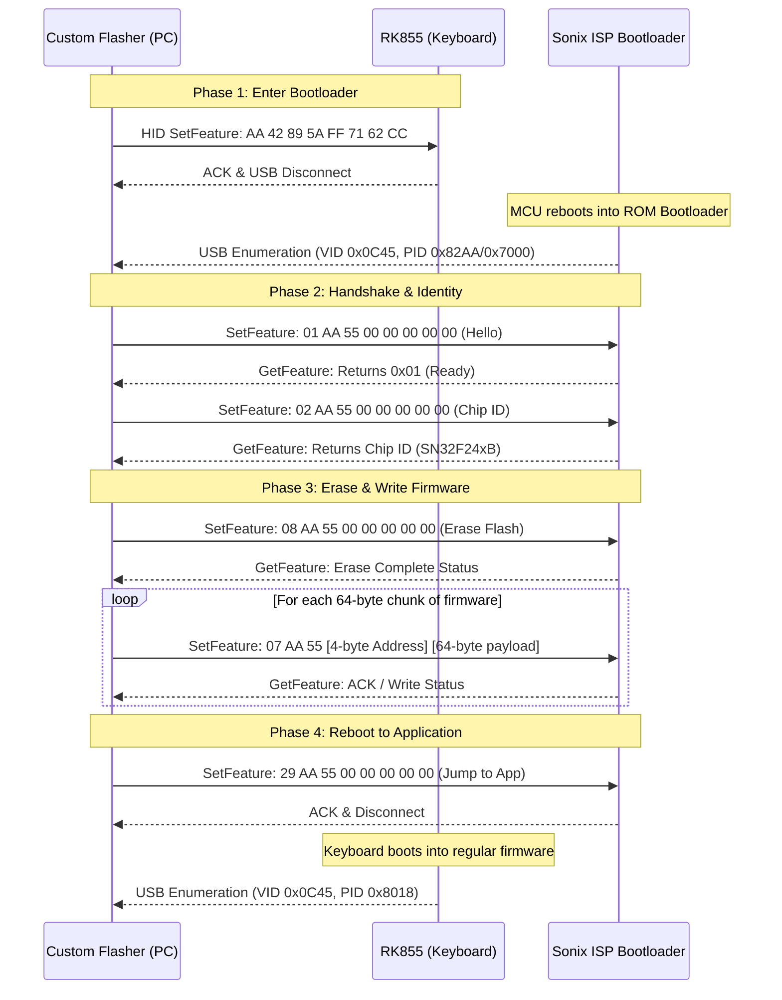

# Reverse Engineering Analysis: Royal Kludge RK855 Firmware Flasher

## 1. Executive Summary

This document provides a complete technical analysis of `RK855_firmware flasher.exe` (SHA-256: `976d7c345492ea2f3e6a51d110b96570d9eddcce97f1cead45613f08a77d4796`), an official firmware updater for the Royal Kludge RK855 (RK68) mechanical keyboard.

The analysis was performed using **REA (Reverse Engineer Anything)**, static PE analysis, and disassembly tools. It details the microcontroller architecture, the exact USB HID ISP (In-System Programming) bootloader protocol, the command to trigger bootloader mode from user space, and the extracted firmware payload, providing all specifications required to build a cross-platform, open-source flasher tool.

---

## 2. Binary & Target Architecture

### 2.1 File Characteristics
- **Filename**: `RK855_firmware flasher.exe`
- **File Size**: 1,917,952 bytes (~1.83 MB)
- **Format**: PE32 executable for MS Windows (GUI), Intel i386 (32-bit x86)
- **Overlay**: None (all assets and code are embedded in PE sections `.text`, `.rdata`, `.data`, `.rsrc`)
- **Framework**: Visual C++ / MFC with dynamic HID and SetupAPI device handling

### 2.2 Target Microcontroller (MCU)
- **Chip Family**: **Sonix SN32F24xB** (ARM Cortex-M0 32-bit RISC core)
- **Flash Memory**: 64 KB (Page size: 64 bytes / 256 bytes depending on sector)
- **SRAM**: 8 KB (Base address: `0x20000000`)
- **ROM / Bootloader Base**: Flash base at `0x00000000`
- **Initial Vector Table (Application Firmware `SN32F240B_32.bin`)**:
  - Initial Stack Pointer (SP): `0x200015B0` (Initialized in SRAM)
  - Reset Handler: `0x000066D1` (Thumb entry address `0x000066D0`)
- **Flasher Embedded RAM Agent Vector Table** (at offset `0x001AC378` in `RK855_firmware_flasher.exe`):
  - Initial Stack Pointer (SP): `0x20000728`
  - Reset Handler: `0x000000D9`

### 2.3 USB Device Identifiers
| Mode | Vendor ID (VID) | Product ID (PID) | Device Name / Description |
| :--- | :--- | :--- | :--- |
| **Factory ROM Default (Apple Profile)** | `0x05AC` | `0x024F` | Compiled factory descriptor in ROM (Mac / BIOS compatible) |
| **Windows Vendor Tool Matching** | `0x0C45` | `0x8018` | Target profile in Windows configurator & flasher inf |
| **Alternative Normal VID/PID** | `0x0C45` | `0x8016`, `0x8008` | RK variant firmware |
| **Sonix ISP Bootloader Mode** | `0x0C45` | `0x7000` – `0x7800` / `0x82AA` | Sonix SN32F24x USB Bootloader Device |

---

## 3. Triggering Bootloader (ISP) Mode

When the keyboard is running its regular firmware, it presents standard USB HID keyboard and vendor endpoints. To flash new firmware without opening the case or shorting boot pins, software sends a vendor-defined unlock command over USB HID.

### 3.1 The Switch Command
The flasher sends an 8-byte command via **HID SetFeature** to the vendor interface:

- **Transport**: USB HID Feature Report
- **Report ID**: `0x00`
- **Length**: 8 bytes
- **Payload (`CheckDeviceCmd`)**:
  ```hex
  AA 42 89 5A FF 71 62 CC
  ```

*(Note: The generic fallback command is `AA 55 A5 5A FF 00 33 CC`, but `AA 42 89 5A FF 71 62 CC` is the specific key configured in `UISettings.ini` for the RK855).*

### 3.2 Device Re-Enumeration
Upon receiving this command:
1. The keyboard MCU acknowledges the report and resets itself into the built-in Sonix ROM bootloader.
2. The USB connection drops and reconnects within 1–2 seconds.
3. The device re-enumerates as a Sonix ISP Bootloader device (`VID: 0x0C45`, `PID: 0x7000`..`0x7800` or `PID: 0x82AA`).

---

## 4. Sonix ISP Bootloader Communication Protocol

Once in bootloader mode, all communication occurs via **HID Feature Reports** (`HidD_SetFeature` to send commands, `HidD_GetFeature` to read status/responses).

### 4.1 Packet Framing
- **Buffer Structure**:
  - Byte 0: Report ID (`0x00`)
  - Bytes 1..8 (or 1..64): Packet data
- **Standard Command Header**:
  - Byte 0: `Opcode`
  - Byte 1: `0xAA` (Magic byte 1)
  - Byte 2: `0x55` (Magic byte 2)
  - Bytes 3..7: Parameters (Addresses, lengths, or flags)

### 4.2 Complete ISP Command Set

| Opcode | Command Name | Packet Format (Hex) | Description |
| :---: | :--- | :--- | :--- |
| `0x01` | **Handshake / Hello** | `01 AA 55 00 00 00 00 00` | Checks bootloader presence; returns status `0x01` |
| `0x02` | **Get Chip ID** | `02 AA 55 00 00 00 00 00` | Reads MCU silicon ID (confirms `SN32F24xB`) |
| `0x03` | **Get Bootloader Ver**| `03 AA 55 00 00 00 00 00` | Reads bootloader version string |
| `0x06` | **Read / Verify Flash**| `06 AA 55 [Addr: 4 bytes] [Len]` | Reads flash page back for verification |
| `0x07` | **Write Flash Page** | `07 AA 55 [Addr: 4 bytes] [64 bytes data]` | Programs 64 bytes of firmware into Flash |
| `0x08` | **Erase Flash** | `08 AA 55 [Sector / Flags: 5 bytes]` | Bulk or page erases user application flash |
| `0x20`–`0x28`| **Extended Commands**| `2X AA 55 ...` | Security configuration and checksum checks |
| `0x29` | **Reset & Run App** | `29 AA 55 00 00 00 00 00` | Exits bootloader and branches to user firmware |

### 4.3 Flashing Sequence Workflow


---

## 5. Extracted Firmware Artifacts

The executable bundles the complete factory firmware inside its PE resource table.

### 5.1 Embedded ZIP Container (`RT_RCDATA` ID 4011)
Located at file offset `0x001BC3A8` (size: 96,771 bytes), extracted to:
`vendor/flasher/` (with firmware image placed in `firmware/`)

Key extracted files:
1. **`Settings\FWFiles\SN32F240B_32.hex`** (166,843 bytes):
   - Format: Standard Intel HEX representation of the factory firmware.
   - Code Size: Covers memory range `0x00000000` to `0x00007FFF` (32 KB active image).
2. **`Settings\UISettings.ini`**:
   - Contains firmware configuration parameters and validation commands:
     ```ini
     [UISettings]
     ISPTitle=HFD ISP Tool
     CheckDeviceCmd=AA42895AFF7162CC
     CheckBootLoaderID=1
     CurVersion=0x0109
     ```
3. **`Settings\UISettings_248B.ini`**:
   - Lists hardware definitions:
     ```ini
     [SpecialPID0]
     VID=0x0C45
     PID=0x8016
     ChipName=SN32F24xB
     FWName=SN32F240B_32.hex
     CodeSecurity=1

     [SpecialPID1]
     VID=0x05AC
     PID=0x024F
     ChipName=SN32F24xB
     FWName=SN32F240B_32.hex
     CodeSecurity=1

     [SpecialPID2]
     VID=0x0C45
     PID=0x8008
     ChipName=SN32F24xB
     FWName=SN32F240B_32.hex
     CodeSecurity=1
     ```

### 5.2 Raw Binary (`RT_RCDATA` ID 4000)
Located at file offset `0x001AC378` (size: 65,536 bytes):
- Raw binary flash dump matching `SN32F240B_32.hex` without hex overhead.
- Can be directly flashed to Sonix SN32F24xB microcontrollers.

---

## 6. Implementation Blueprint: Python Cross-Platform Flasher

Using the reverse-engineered commands, an alternative flasher can be constructed using `hidapi` (cross-platform for Linux, macOS, and Windows):

```python
import hid
import time

BOOT_CMD = bytes([0x00, 0xAA, 0x42, 0x89, 0x5A, 0xFF, 0x71, 0x62, 0xCC])

def trigger_bootloader(vid=0x0C45, pid=0x8018):
    """Sends the unlock command to switch from keyboard to bootloader."""
    dev = hid.device()
    try:
        dev.open(vid, pid)
        print("[+] Connected to RK855 in Keyboard Mode.")
        dev.send_feature_report(BOOT_CMD)
        print("[+] Bootloader trigger sent. Device resetting...")
        dev.close()
    except Exception as e:
        print(f"[-] Could not open device: {e}")

def flash_firmware(hex_path, bootloader_vid=0x0C45, bootloader_pid=0x82AA):
    """Connects to Sonix Bootloader and writes firmware pages."""
    time.sleep(2.0) # Wait for USB re-enumeration
    dev = hid.device()
    dev.open(bootloader_vid, bootloader_pid)
    print("[+] Connected to Sonix ISP Bootloader.")

    # 1. Handshake
    dev.send_feature_report(bytes([0x00, 0x01, 0xAA, 0x55, 0, 0, 0, 0, 0]))
    resp = dev.get_feature_report(0, 9)
    print(f"[+] Handshake response: {resp.hex()}")

    # 2. Erase user flash
    dev.send_feature_report(bytes([0x00, 0x08, 0xAA, 0x55, 0, 0, 0, 0, 0]))
    time.sleep(0.5)

    # 3. Write Pages (64 bytes chunks from HEX)
    # dev.send_feature_report([0x00, 0x07, 0xAA, 0x55, addr_b0, addr_b1, addr_b2, addr_b3] + chunk)

    # 4. Jump to User Code
    dev.send_feature_report(bytes([0x00, 0x29, 0xAA, 0x55, 0, 0, 0, 0, 0]))
    print("[+] Firmware flashed successfully. Device rebooted.")
    dev.close()
```
