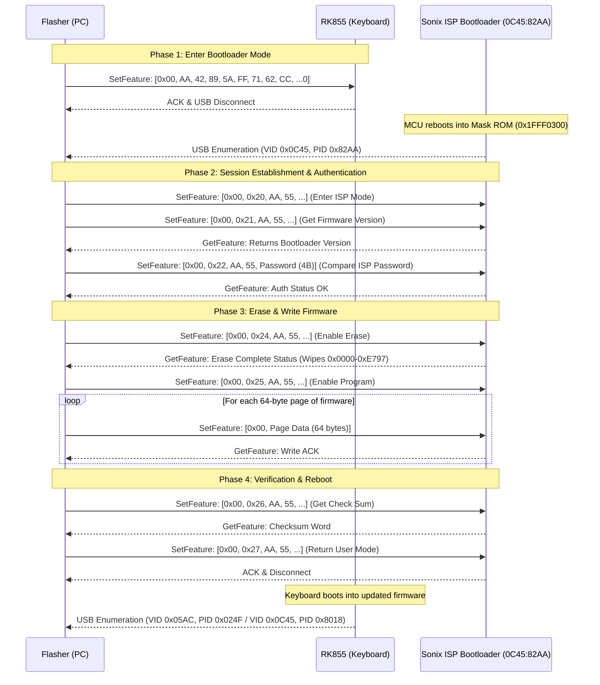

# Reverse Engineering Analysis: Royal Kludge RK855 Firmware Flasher

## 1. Executive Summary

This document provides a complete technical analysis of `RK855_firmware_flasher.exe` (SHA-256: `976d7c345492ea2f3e6a51d110b96570d9eddcce97f1cead45613f08a77d4796`), the official firmware updater for the Royal Kludge RK855 (RK68) mechanical keyboard.

The analysis was performed using **REA (Reverse Engineer Anything)**, static PE analysis, and disassembly tools (Capstone, pefile). It details the microcontroller architecture, the dual-family USB HID ISP (In-System Programming) bootloader protocol, the exact command to trigger bootloader mode from user space, and the extracted firmware payloads (Resource 4000 template vs. Resource 4011 factory image), providing all specifications required to build a safe, cross-platform, open-source flasher tool.

---

## 2. Binary & Target Architecture

### 2.1 File Characteristics
- **Filename**: `RK855_firmware_flasher.exe`
- **File Size**: 1,917,952 bytes (~1.83 MB)
- **Format**: PE32 executable for MS Windows (GUI), Intel i386 (32-bit x86)
- **Overlay**: None (all assets and code are embedded in PE sections `.text`, `.rdata`, `.data`, `.rsrc`)
- **Framework**: Visual C++ / MFC with dynamic HID and SetupAPI device handling
- **Internal Identifiers**: `SONiX USB MCU ISP Tool`, supporting SN8F 8-bit and SN32F 32-bit MCUs

### 2.2 Target Microcontroller (MCU)
- **Chip Family**: **Sonix SN32F24xB** (ARM Cortex-M0 32-bit RISC core @ 48 MHz)
- **Flash Memory**: 64 KB total (Page size: strictly **64 bytes**)
- **SRAM**: 8 KB (Base address: `0x20000000`, bounds `0x20000000`–`0x20001FFF`)
- **ROM / Bootloader Base**: 3 KB Mask ROM at `0x1FFF0000`–`0x1FFF0BFF` (entry at `0x1FFF0300`), remapped through `SYS0_IVTM` (`0x40060024`, key `0xA5A5`)
- **Hardware Boot Pin**: `P2.2` (Pin 3 of LQFP64 / Pin 4 of QFN33; internal pull-up; pull LOW at boot to hardware-force ISP bootloader mode)
- **Initial Vector Table of Target Keyboard (`SN32F240B_32.bin`)**:
  - Initial Stack Pointer (SP): `0x200015B0` (located at flash offset `0x00000000`)
  - Reset Handler: `0x000066D1` (Thumb entry address `0x000066D0` at flash offset `0x00000004`)
  - Reset Execution Flow: `0x66D0` loads literal `0x000000C1` and branches to `0x000000C0` (`__main` C runtime startup), which clears BSS, copies data, and enters `main` at `0x00000620`.
  - First 16 bytes of `SN32F240B_32.bin`:
    ```hex
    b0 15 00 20 d1 66 00 00 d1 66 00 00 d1 66 00 00
    ```
- **Flasher Embedded Template Vector Table (`RT_RCDATA` Resource 4000)**:
  - Initial Stack Pointer (SP): `0x20000728`
  - Reset Handler: `0x000000D9`
  - First 16 bytes of Resource 4000:
    ```hex
    28 07 00 20 d9 00 00 00 e1 00 00 00 a1 05 00 00
    ```
  - *(Note: Resource 4000 is an embedded generic Sonix ISP template/RAM agent payload [SHA-256 `8324f1bc...`], NOT the RK855 target keyboard firmware. The actual target keyboard firmware is bundled inside Resource 4011).*

### 2.3 USB Device Identifiers
| Mode | Vendor ID (VID) | Product ID (PID) | Device Name / Description |
| :--- | :--- | :--- | :--- |
| **Factory ROM Default (Apple Profile)** | `0x05AC` | `0x024F` | Compiled factory descriptor in ROM (`0x6ABC`) for native macOS/BIOS compatibility |
| **Windows Vendor Driver Filter** | `0x0C45` | `0x8018` | Single-device filter in `vendor/configurator/app/device.xml` (`RK KeyBoard 68K`) |
| **Alternative Runtime PIDs** | `0x0C45` | `0x8016`, `0x8008` | Listed in flasher `UISettings_248B.ini` as `SpecialPID0` and `SpecialPID2` |
| **Sonix ISP Bootloader Mode** | `0x0C45` | `0x82AA` | Sonix SN32F24xB USB ISP Bootloader Device |

---

## 3. Triggering Bootloader (ISP) Mode

When the keyboard is running its regular firmware, it presents standard USB HID keyboard and vendor endpoints. To flash new firmware without opening the case or shorting boot pins, software sends a vendor-defined unlock command over USB HID.

### 3.1 The Switch Command
The flasher sends an 8-byte command via **HID SetFeature** to Interface 0:

- **Transport**: USB HID Feature Report
- **Target Interface**: Interface 0 (`wIndex = 0` / `&MI_00`)
- **Report ID**: `0x00`
- **Length**: 8 command bytes (padded to 64 payload bytes / 65 wire bytes)
- **Payload (`CheckDeviceCmd`)**:
  ```hex
  AA 42 89 5A FF 71 62 CC
  ```

*(Note: The generic fallback command is `AA 55 A5 5A FF 00 33 CC`, but `AA 42 89 5A FF 71 62 CC` is the specific key configured in `UISettings.ini` and verified in the firmware EP0 handler at `0x00001790`).*

### 3.2 Device Re-Enumeration
Upon receiving this command:
1. The keyboard MCU verifies the 8-byte signature at `0x00001794` and `0x0000179E`.
2. The EP0 buffer is cleared, and execution branches to `0x0000014C`.
3. The function writes to `SYS0_IVTM` (`0x40060024`, Interrupt Vector Table Mapping register) and executes `bx r0` to jump directly into Mask ROM bootloader vector `0x1FFF0301`.
4. If the firmware is non-functional, pulling hardware pin `P2.2` (Pin 3 on LQFP64) LOW during boot forces the MCU directly into the bootloader with SWD enabled.
5. The USB connection drops and reconnects within 1–2 seconds.
6. The device re-enumerates as the Sonix ISP Bootloader (`VID: 0x0C45`, `PID: 0x82AA`).

---

## 4. Sonix ISP Bootloader Communication Protocol

Once in bootloader mode, all communication occurs via **HID Feature Reports** (`HidD_SetFeature` to send commands, `HidD_GetFeature` to read status/responses).

### 4.1 Packet Framing
- **Buffer Structure**:
  - Byte 0: Report ID (`0x00`)
  - Bytes 1..64: 64-byte payload
- **Standard Command Header**:
  - `payload[0]`: `Opcode`
  - `payload[1]`: `0xAA` (Magic byte 1)
  - `payload[2]`: `0x55` (Magic byte 2)
  - `payload[3..7]`: Parameters (Addresses, lengths, or flags)
  - `payload[8..63]`: Additional data / zero padding

### 4.2 Sonix ISP Dual Command Architecture

Static disassembly of `RK855_firmware_flasher.exe` (`0x54F340`–`0x54F519`) reveals that the executable is Sonix's universal ISP flashing utility. It implements two distinct command sets:

1. **Legacy 8-Bit SN8F Command Set (`0x01`–`0x09`)**:
   Designed for 8-bit microcontrollers (e.g. SN8F2288B):
   - `0x01`: Get Firmware Version
   - `0x02`: Compare ISP Password
   - `0x03`: Set Encryption Algorithm
   - `0x04`: Enable Erase
   - `0x05`: Enable Program
   - `0x06`: Get Check Sum
   - `0x07`: Return User Mode
   - `0x08`: Set Code Option
   - `0x09`: Get Code Option

2. **Cortex-M0 SN32F Command Set (`0x20`–`0x2A`)**:
   Designed for 32-bit Cortex-M0 microcontrollers (SN32F24xB / SN32F26x):
   - `0x20`: Enter ISP Mode
   - `0x21`: Get Firmware Version
   - `0x22`: Compare ISP Password
   - `0x23`: Set Encryption Algorithm
   - `0x24`: Enable Erase
   - `0x25`: Enable Program
   - `0x26`: Get Check Sum
   - `0x27`: Return User Mode
   - `0x28`: Set Code Option
   - `0x29`: Get Code Option
   - `0x2A`: Enable Check Data

> [!CAUTION]
> **Resolution of Item D1 & Safety Warning on Shipped Tools**:
> Early open-source flasher implementations assumed that `0x08` was "Erase Flash", `0x07` was "Write Flash Page", and `0x29` was "Reboot to User Code".
> Disassembly of the vendor flasher proves this was incorrect:
> - Opcode `0x08` in Sonix command tables is **Set Code Option** (which writes security/fuse registers!).
> - Opcode `0x07` is **Return User Mode** (reboot).
> - Opcode `0x29` is **Get Code Option** (read configuration bits).
> For SN32F Cortex-M0 devices, Erase is triggered via `0x24` (**Enable Erase**), Program is enabled via `0x25` (**Enable Program**), and reboot is `0x27` (**Return User Mode**). Sending unverified opcodes like `0x08` risks altering hardware fuses or code security settings.

### 4.3 Verified Transport Framing
In `RK855_firmware_flasher.exe` (`0x420B79` and `0x420C96`):
1. The flasher queries `FeatureReportByteLength` from the operating system via `HidP_GetCaps`.
2. It constructs a buffer starting with Report ID `0x00` (`mov byte ptr [0x5daf40], 0` at `0x420AF6`).
3. Payload bytes are copied into `0x5daf41` onwards.
4. The buffer is passed to `HidD_SetFeature` (`0x421692`) with length matching the declared report size (65 bytes: 1 byte Report ID + 64 bytes payload).
5. Responses are retrieved using `HidD_GetFeature` (`0x421698`) after a 5–10 ms pause (`push 5; call Sleep`).

### 4.4 Flashing Sequence Workflow


---

## 5. Extracted Firmware Artifacts

The flasher binary contains two distinct firmware-related resources:

### 5.1 Factory Firmware ZIP Container (`RT_RCDATA` ID 4011)
Located at file offset `0x001BC3A8` (size: 96,771 bytes), extracted to `vendor/flasher/`:

Key extracted files:
1. **`Settings\FWFiles\SN32F240B_32.hex`** (166,843 bytes):
   - **SHA-256**: `ba0f38cb1276077959f8851b2bd38db524d495c980837e549f91ed8ba1d592f0`
   - Memory Span: `0x00000000` to `0x0000FFFF` (64 KB address space).
   - Covered Records: Exactly **59,292 bytes** populated across `0x00000000`–`0x0000E797` (59,288 B) and `0x0000FFFC`–`0x0000FFFF` (4 B validity marker `0xAAAA5555`).
   - Unpopulated Gap: 6,244 bytes from `0x0000E798` to `0x0000FFFB` (unwritten flash filled with `0xFF`).
   - **Hardware Flash Validity Marker (`0xAAAA5555` at `0xFFFC`)**:
     An alternating bit pattern (`1010101010101010 0101010101010101`). This is a hardcoded validity signature checked by the Sonix mask ROM bootloader before booting user code, NOT a calculated arithmetic checksum. Flashing tools MUST write this word to `0xFFFC` or the bootloader will reject the image and remain in ISP mode.
2. **`Settings\UISettings.ini`**:
   - Flasher configuration:
     ```ini
     [UISettings]
     ISPTitle=HFD ISP Tool
     CheckDeviceCmd=AA42895AFF7162CC
     CheckBootLoaderID=1
     CurVersion=0x0109
     ```
3. **`Settings\UISettings_248B.ini`**:
   - Runtime device PID table (`SpecialPID`):
     ```ini
     [SpecialPID0]
     VID=0x0C45
     PID=0x8016
     ChipName=SN32F24xB
     FWName=SN32F240B_32.hex
     CodeSecurity=1

     [SpecialPID1]
     VID=0x05AC
     PID=0x024F
     ChipName=SN32F24xB
     FWName=SN32F240B_32.hex
     CodeSecurity=1

     [SpecialPID2]
     VID=0x0C45
     PID=0x8008
     ChipName=SN32F24xB
     FWName=SN32F240B_32.hex
     CodeSecurity=1
     ```

### 5.2 Embedded Template / RAM Agent (`RT_RCDATA` ID 4000)
Located at file offset `0x001AC378` (size: 65,536 bytes):
- **SHA-256**: `8324f1bc059cae33c21066c44ac8e18faa161b6389c9987dc99cdc4cd5b889c7`
- Initial Stack Pointer: `0x20000728`, Reset Vector: `0x000000D9`.
- **Purpose**: This is an embedded generic Sonix ISP template/RAM agent payload compiled into the generic ISP tool, completely separate from the RK855 keyboard firmware. Flashing tools must NOT use Resource 4000 as the keyboard firmware.
