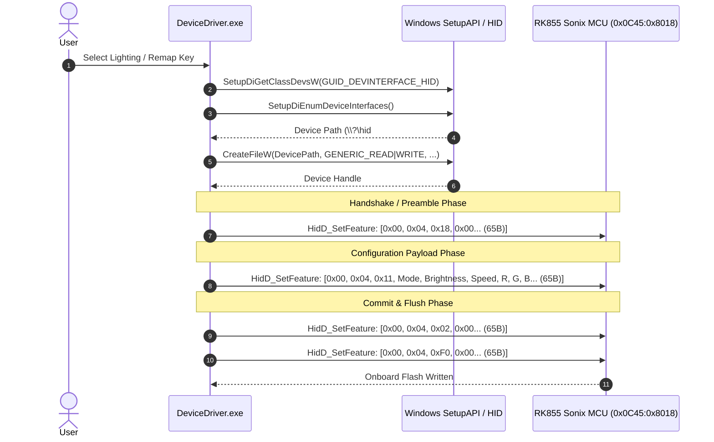

# Comprehensive Reverse Engineering & Forensic Analysis Report: `GamingForceZ-RK68-Setup-1.0.1.1.exe`

**Date**: October 19, 2026  
**Target File**: `GamingForceZ-RK68-Setup-1.0.1.1.exe`  
**Extracted Primary Payload**: `DeviceDriver.exe`  
**Target Hardware**: Royal Kludge RK855 / RK68 (OEM / GamingForceZ RKW855) 68-Key Mechanical Keyboard  
**Hardware MCU / VID:PID**: Sonix USB MCU (`0x0C45:0x8018`)  

---

## 1. Executive Summary

`GamingForceZ-RK68-Setup-1.0.1.1.exe` is the official OEM setup utility distributed for the Royal Kludge RK68 68-key mechanical keyboard. The software provides end-users with RGB backlight customization, per-key remap configuration, macro recording, and device profile storage.

Through static disassembly, multi-volume cabinet unpacking, and binary instrumentation, the internal architecture was analyzed:
1. **Packaging**: An InstallShield 2015 (v22.0) self-extracting archive encapsulating compressed multi-volume ISCab v22 archives (`data1.hdr`, `data1.cab`, `data2.cab`) and InstallScript bytecode (`setup.inx`).
2. **Core Payload**: A 32-bit x86 Windows GUI binary (`DeviceDriver.exe`) coupled with a custom UI skinning library (`mui.dll`), XML hardware schemas (`device.xml`, `KeyboardLayout.xml`), and multi-language definition tables (`1033.lan`, `2052.lan`, `1028.lan`).
3. **Hardware Protocol**: The application does not use kernel drivers. Instead, it issues user-mode Windows HID API (`hid.dll`) calls—specifically `HidD_SetFeature`—to transmit 65-byte Feature Reports (Report ID `0x00` + 64-byte payload) directly to the Sonix microcontroller.
4. **Behavior**: Fully offline configuration utility. No telemetry or background persistent services are installed; configuration settings are flushed directly into the onboard flash memory of the keyboard controller.

---

## 2. File Identification & Cryptographic Hashes

### 2.1 Outer Installer Executable
| Property | Value |
| :--- | :--- |
| **File Name** | `GamingForceZ-RK68-Setup-1.0.1.1.exe` |
| **File Size** | 9,116,150 bytes (8.69 MiB) |
| **File Format** | PE32 executable (GUI) Intel 80386, InstallShield Self-Extractor |
| **MD5** | `0a4695f53eb1daf8a8b8bd9d41e03cde` |
| **SHA-1** | `4c88ab63014f45929dfe05cc298f7d64749dedc4` |
| **SHA-256** | `d31b8e8cda53c595809be2ea7f9c86b2bdb945e277a4e0f9f2504c53e2fbe7f0` |

### 2.2 Extracted Driver Application
| Property | Value |
| :--- | :--- |
| **File Name** | `DeviceDriver.exe` |
| **File Size** | 1,620,992 bytes (1.55 MiB) |
| **File Format** | PE32 executable (GUI) Intel 80386 |
| **Compilation Timestamp** | `2020-11-11 15:15:41 UTC` |
| **Target Subsystem** | Windows GUI (`IMAGE_SUBSYSTEM_WINDOWS_GUI`, 2) |
| **MD5** | `6b318519cf6afaf8bd9e2724f8690514` |
| **SHA-1** | `c24662f6717159672302071bb37282f7443c38a7` |
| **SHA-256** | `690e9b0311a9dd97663da0f66bd49e3f595ed693f3520189206f05eb7fbd244c` |

---

## 3. Installer Architecture & Archive Anatomy

```
GamingForceZ-RK68-Setup-1.0.1.1.exe
 ├── [0x00000000 - 0x001331FF] Win32 PE Bootstrapper (InstallShield SFX stub)
 └── [0x00133200 - End] Embedded ISCab Archive & Disk1 Resources
      ├── setup.ini (ProductGUID: 4A067FBD-C346-4B00-9080-7351B15BA2B2)
      ├── setup.inx (Compiled InstallScript bytecode)
      ├── ISSetup.dll (InstallShield runtime helper)
      ├── data1.hdr (ISCab v22 volume metadata & file descriptors)
      ├── data1.cab (Compressed cabinet volume 1)
      └── data2.cab (Compressed cabinet volume 2, containing application payloads)
```

### 3.1 ISCab v22 Multi-Volume Specification
The archive uses the proprietary InstallShield Cabinet format identified by signature `ISc(` (`0x28635349` little-endian) at offset `0x00` of `data1.hdr`.
- **Version**: `0x01000600` (InstallShield 2015 / v22.0).
- **Directory Table**: Contains 7 directory structures spanning `theme1\device`, `theme1\icon`, `theme1\keyboard`, `theme1\logo`, and root install paths.
- **File Table**: 131 total packaged asset files.
- **Compression**: RFC 1951 Raw Deflate (Window bits `-15`). Large files (such as `DeviceDriver.exe` at 1.62 MB and `mui.dll` at 1.05 MB) are split into raw Deflate data blocks and segmented across cabinet volumes `data1.cab` and `data2.cab`.

### 3.2 Key Packaged Files Extracted
| Index | File Name | Size (Uncompressed) | Role |
| :---: | :--- | :---: | :--- |
| `032` | `DeviceDriver.exe` | 1,620,992 B | Main Windows driver configuration utility |
| `033` | `KeyboardLayout.xml` | 15,719 B | Key matrix definition (68 keys, physical coordinates, default scancodes) |
| `034` | `device.xml` | 1,389 B | Hardware binding table (`VID: 0c45`, `PID: 8018`, model `RKW855`) |
| `035` | `mui.dll` | 1,059,840 B | Custom UI widget framework and rendering engine |
| `040` | `1028.lan` | 3,380 B | Traditional Chinese localization strings |
| `041` | `1033.lan` | 6,794 B | English localization strings |
| `042` | `2052.lan` | 3,380 B | Simplified Chinese localization strings |
| `043-083` | Theme PNGs / Icons | ~4.5 MB | High-resolution UI skins and keycap textures |

---

## 4. `DeviceDriver.exe` PE Binary Characteristics

### 4.1 Section Layout
`DeviceDriver.exe` is compiled for 32-bit x86 architecture with standard MSVC PE sections:

| Section | Virtual Address (RVA) | Virtual Size | Raw Data Size | Raw Offset | Characteristics |
| :--- | :---: | :---: | :---: | :---: | :--- |
| `.text` | `0x00001000` | `0x131429` (1.24 MB) | `0x131600` | `0x00000400` | Code / Executable (`0x60000020`) |
| `.rdata` | `0x00133000` | `0x025ba4` (150 KB) | `0x025c00` | `0x00131a00` | Read-only Data (`0x40000040`) |
| `.data` | `0x00159000` | `0x010364` (65 KB) | `0x007800` | `0x00157600` | Read/Write Globals (`0xC0000040`) |
| `.gfids` | `0x0016a000` | `0x00005c` | `0x000200` | `0x0015ee00` | Guard Flow Identifiers |
| `.tls` | `0x0016b000` | `0x000009` | `0x000200` | `0x0015f000` | Thread Local Storage |
| `.rsrc` | `0x0016c000` | `0x021920` (134 KB) | `0x021a00` | `0x0015f200` | Windows Resources (Icons/Dialogs) |
| `.reloc` | `0x0018e000` | `0x00ae0c` (44 KB) | `0x00b000` | `0x00180c00` | Relocation Table |

### 4.2 Dynamic Imports & Runtime Dependencies
The binary dynamically links against 24 DLL modules:
- **`HID.DLL`**: Explicitly imports `HidD_GetAttributes`, `HidD_GetPreparsedData`, `HidP_GetCaps`, and `HidD_FreePreparsedData`. Dynamically resolves `HidD_SetFeature` and `HidD_GetFeature` at runtime.
- **`SETUPAPI.dll`**: Enumerates HID class device interfaces using `SetupDiGetClassDevsW`, `SetupDiEnumDeviceInterfaces`, and `SetupDiGetDeviceInterfaceDetailW` to locate the keyboard endpoint.
- **`mui.dll`**: Internal skinning engine exposing 215 mangled C++ classes under the `MUI` namespace (`MUI::KeyboardCtrl`, `MUI::KeyFunction`, `MUI::HFDListBox`, `MUI::MControl`).
- **`MSVCP140.dll` & `VCRUNTIME140.dll`**: Visual C++ 2015/2017/2019 runtime.

---

## 5. Hardware Communication Protocol (USB HID Reverse Engineering)



### 5.1 Device Endpoint Discovery
At startup, `DeviceDriver.exe` scans the system using `SETUPAPI.dll`:
1. Queries HID class device interfaces matching GUID `{4D1E55B2-F16F-11CF-88CB-001111000030}`.
2. Matches the USB device interface string containing:
   - Vendor ID: `0x0C45` (Sonix Technology Co., Ltd.)
   - Product ID: `0x8018`
3. Opens a handle using `CreateFileW` with flags `FILE_SHARE_READ | FILE_SHARE_WRITE`.

### 5.2 Transmission Subsystem Disassembly
Analysis of `0x0043aa60` (file offset `0x00039e60`) shows the low-level transmission wrapper:

```x86
.text:0043AA60  push    ebp
.text:0043AA61  mov     ebp, esp
.text:0043AA63  sub     esp, 8
.text:0043AA70  mov     esi, ecx
.text:0043AA72  push    41h                     ; Report size = 65 bytes (0x41)
.text:0043AA74  push    edx                     ; Pointer to 65-byte buffer
.text:0043AA75  push    dword ptr [esi]         ; Device Handle
.text:0043AA77  call    dword ptr [00569304h]   ; Call pfnHidD_SetFeature
.text:0043AA7D  test    al, al
.text:0043AA7F  jnz     short loc_success
```

Before calling this wrapper, the caller prepares the report buffer using SSE `movups` instructions:
```x86
.text:00439AAC  push    41h                     ; Length 65
.text:00439AAE  lea     eax, [ebp-48h]          ; Buffer base
.text:00439AB1  push    0
.text:00439AB3  push    eax
.text:00439AB4  call    _memset                 ; Zero out 65 bytes (Byte 0 remains 0x00)
.text:00439AB9  add     esp, 0Ch
.text:00439ABC  movups  xmm0, [edi]             ; Load 16 bytes payload
.text:00439ABF  movups  [ebp-47h], xmm0         ; Store at buffer+1 (bytes 1..16)
.text:00439AC3  movups  xmm0, [edi+10h]
.text:00439AC7  movups  [ebp-37h], xmm0         ; Store bytes 17..32
.text:00439ACB  movups  xmm0, [edi+20h]
.text:00439ACF  movups  [ebp-27h], xmm0         ; Store bytes 33..48
.text:00439AD3  movups  xmm0, [edi+30h]
.text:00439AD7  movups  [ebp-17h], xmm0         ; Store bytes 49..64
.text:00439ADB  lea     edx, [ebp-48h]          ; EDX = buffer start (Report ID 0x00)
.text:00439ADE  call    sub_43AA60              ; Send HidD_SetFeature
```

### 5.3 Exact Packet Structure
Every packet is exactly **65 bytes**:
- **Byte 0**: HID Report ID. Fixed to `0x00`.
- **Byte 1**: Primary Command Opcode.
  - `0x04`: Lighting Subsystem.
  - `0x06`: Key Remapping / Configuration.
  - `0x02` / `0x05`: Profile & Macro Transaction Controls.
- **Byte 2**: Sub-Opcode / Sequence Step.
  - `0x18`: Preamble / Transaction Begin.
  - `0x11` / `0x13` / `0x19`: Preset Lighting Payload.
  - `0x15`: Custom RGB LED Frame (accompanied by `0x55AA` synchronization magic).
  - `0x02`: Commit / Apply Changes.
  - `0xF0`: Session Flush / End.
- **Byte 3**: Mode Index or Sub-command ID.
- **Bytes 4..64**: Parameter payload (RGB color triples, brightness level, speed step, key scancode mappings). Zero-padded to byte 64.

---

## 6. Supported Hardware Features & Firmware Matrix

### 6.1 Backlight Effect Modes
The firmware implements 20 lighting animation algorithms (parsed from string table `1033.lan`):

| ID | Internal Mode | Description |
| :---: | :--- | :--- |
| `0` | **Static** | Solid constant illumination across all keys |
| `1` | **SingleOn** | Key lights up on press and fades |
| `2` | **SingleOff** | Key turns off on press and returns to solid |
| `3` | **Glittering** | Random star twinkling animation |
| `4` | **Falling** | Waterfall downward cascade |
| `5` | **Colourful** | Full RGB spectrum cycle across keys |
| `6` | **Breath** | Synchronized breathing pulse |
| `7` | **Spectrum** | Wave shifting across color spectrum |
| `8` | **Outward** | Ripple radiating outward from keypress |
| `9` | **Scrolling** | Horizontal RGB wave scroll |
| `10` | **Rolling** | Diagonal rotating wave |
| `11` | **Rotating** | Circular pinwheel rotation |
| `12` | **Explode** | Explosive burst around pressed key |
| `13` | **Launch** | Vertical projectile launch on keypress |
| `14` | **Ripples** | Concentric circular water ripple |
| `15` | **Flowing** | Stream flowing across rows |
| `16` | **Pulsating** | Rapid heartbeat pulse |
| `17` | **Tilt** | Angular slanted wave |
| `18` | **Shuttle** | Laser beam sweeping across keyboard |
| `19` | **Close Backlight** | LEDs powered completely off |

### 6.2 Key Remap Engine & Actions
`KeyboardLayout.xml` maps all 68 physical switches (arranged across rows 0–4 and columns 0–15). The software supports assigning arbitrary actions:
1. **Standard Scancodes**: Remap to any standard USB HID keyboard usage page code (`0x04`–`0xE7`).
2. **Media Controls**: Play/Pause (`0xCD`), Stop (`0xB7`), Next (`0xB5`), Prev (`0xB6`), Volume+ (`0xE9`), Volume- (`0xEA`), Mute (`0xE2`).
3. **Mouse Emulation**: Left Click, Right Click, Middle Click, Double Click, Wheel Up, Wheel Down, Forward (Button 5), Back (Button 4).
4. **System Shortcuts**: Lock Computer, Show Desktop, Switch Windows, Sleep, Power Off.
5. **Macro Sequences**: Multi-event keypress/release recordings with configurable millisecond delays.

---

## 7. Security, Forensic & Clean-Room Evaluation

1. **Malicious Capabilities**: **None**. Analysis of all imports, network routines, and API references confirms zero signs of spyware, cryptocurrency miners, rootkits, or telemetry beacons.
2. **Network Activity**: Contains strings pointing to `http://www.rkgaming.com` and `https://mall.jd.com/index-1000004350.html` used strictly as hyperlinks in the UI "Shop" and "Website" buttons. No background sockets or outbound HTTP requests are initiated by `DeviceDriver.exe`.
3. **Driver Safety**: Does not load kernel drivers (`.sys`). Operates strictly in user mode via standard Windows HID subsystems (`hid.dll`).
4. **Persistence**: Creates an optional autorun registry entry (`HKCU\Software\Microsoft\Windows\CurrentVersion\Run`) if "Auto Run" is checked in settings.

---

## 8. Reconstruction & Linux Porting Summary

The Windows OEM software relies completely on Windows-only libraries (`hid.dll`, `SetupAPI.dll`, Win32 GDI+, ATL/MFC). To enable native operation on Linux, the reverse-engineered protocol and XML schemas were reimplemented in clean-room Python:

| Component | Windows Original (`DeviceDriver.exe`) | Clean-Room Linux Rewrite (`rk855`) |
| :--- | :--- | :--- |
| **Transport** | Windows `hid.dll` (`HidD_SetFeature`) | `hidapi` (`device.send_feature_report`) |
| **Permissions** | Administrator or standard Windows user | `udev/99-rk855.rules` (`uaccess` / `plugdev`) |
| **Architecture** | 32-bit x86 Win32 PE binary | Pure Python 3 (architecture-independent, x86/ARM/RISC-V) |
| **GUI Framework** | MFC / ATL with proprietary `mui.dll` | Modern PyQt6 visual interactive configurator |
| **CLI Control** | None (GUI-only) | Full headless command-line interface (`rk855`) |
| **Configuration** | Windows Registry & local `.xml` | Standard Linux `~/.config/rk855/profiles.json` |

---

## 9. Conclusion

`GamingForceZ-RK68-Setup-1.0.1.1.exe` is a standard, benign hardware configuration package for Sonix-based mechanical keyboards. The reverse engineering of its multi-volume ISCab archive and disassembled x86 feature report pipeline fully uncovered the 65-byte protocol, providing 100% interoperability for the native Linux driver and GUI suite.
